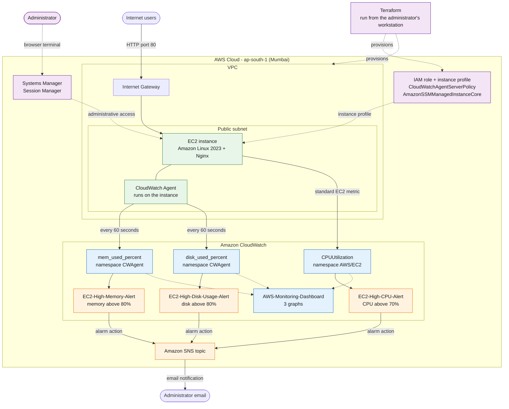

<div align="center">

# AWS Monitoring & Alerting System

**A Terraform-provisioned Amazon EC2 web server, monitored with CloudWatch Agent metrics, CloudWatch alarms, a dashboard, and SNS email alerts.**


-FF9900?style=flat-square&logo=amazonaws&logoColor=white)


[Overview](#project-overview) ·
[Architecture](#architecture-diagram) ·
[Deploy](#infrastructure-provisioning) ·
[Monitoring](#cloudwatch-alarms) ·
[Evidence](#testing-and-validation-evidence) ·
[Interview Q&A](#interview-questions-and-answers) ·
[Roadmap](#future-enhancements)

</div>

---

## Table of Contents

1. [Project Overview](#project-overview)
2. [Current Project Status](#current-project-status)
3. [Key Features](#key-features)
4. [Project Objectives](#project-objectives)
5. [Architecture Diagram](#architecture-diagram)
6. [Architecture Explanation](#architecture-explanation)
7. [Technologies and AWS Services](#technologies-and-aws-services)
8. [Terraform Directory Structure](#terraform-directory-structure)
9. [Infrastructure Provisioning](#infrastructure-provisioning)
10. [Website Deployment and Verification](#website-deployment-and-verification)
11. [CloudWatch Agent Installation and Configuration](#cloudwatch-agent-installation-and-configuration)
12. [Memory and Disk Metrics](#memory-and-disk-metrics)
13. [CloudWatch Alarms](#cloudwatch-alarms)
14. [SNS Email Notifications](#sns-email-notifications)
15. [CloudWatch Dashboard](#cloudwatch-dashboard)
16. [Testing and Validation Evidence](#testing-and-validation-evidence)
17. [Troubleshooting and Lessons Learned](#troubleshooting-and-lessons-learned)
18. [Security Best Practices](#security-best-practices)
19. [Cost Optimization and Cleanup](#cost-optimization-and-cleanup)
20. [Interview Questions and Answers](#interview-questions-and-answers)
21. [Future Enhancements](#future-enhancements)
22. [Project Screenshots](#project-screenshots)
23. [Author](#author)

---

## Project Overview

This is a hands-on AWS and DevOps learning project. It answers a simple question: **if a web server starts running out of CPU, memory, or disk space, how do I find out quickly?**

The project does this in four steps:

1. **Build** the infrastructure with Terraform: a network, a firewall, an IAM role, and an Amazon Linux 2023 EC2 instance running Nginx.
2. **Measure** the server with Amazon CloudWatch. EC2 reports CPU on its own, and the CloudWatch Agent adds memory and disk usage from inside the operating system.
3. **Detect** problems with three CloudWatch alarms that watch CPU, memory, and disk thresholds.
4. **Notify** the administrator by email through Amazon SNS.

A CloudWatch dashboard shows the three metrics side by side, and AWS Systems Manager Session Manager provides browser-based terminal access to the server without needing an open SSH port.

> [!NOTE]
> This is a small, low-cost learning project, not an enterprise product. The README separates what is implemented, what is tested, and what is only planned, so nothing is overstated.

---

## Current Project Status

The infrastructure and monitoring stack are **deployed in `ap-south-1` (Asia Pacific, Mumbai)**. The table below is the single source of truth for status, and every other section agrees with it.

| Area | Status |
|------|--------|
| Terraform infrastructure (VPC, subnet, IGW, routes, security group, IAM, EC2) | Deployed |
| Nginx website on EC2 | Deployed and verified in a browser |
| CloudWatch Agent | Installed, configured, and running |
| CPU, memory, and disk metrics | Visible in CloudWatch |
| Systems Manager Session Manager | Working |
| Three CloudWatch alarms | Created |
| SNS email subscription | Confirmed |
| CPU alarm notification path | Tested end to end |
| Memory and disk alarm notification paths | **Created, not yet tested end to end** |
| CloudWatch dashboard `AWS-Monitoring-Dashboard` | Created |
| GitHub Actions, CI/CD, Java Lambda remediation | **Planned only, not implemented** |

---

## Key Features

- **Infrastructure as Code:** the network, firewall, IAM role, and EC2 instance are defined in reviewable Terraform files.
- **Automated web server setup:** Nginx is installed through a bootstrap script on an Amazon Linux 2023 instance.
- **Guest OS metrics:** the CloudWatch Agent publishes `mem_used_percent` and `disk_used_percent` every 60 seconds under the `CWAgent` namespace.
- **Threshold alarms:** three CloudWatch alarms for CPU, memory, and disk usage.
- **Email alerting:** alarms can publish to an SNS topic with a confirmed email subscription.
- **Dashboard:** one CloudWatch dashboard with three graphs.
- **Secure administration:** Session Manager gives terminal access through IAM, so SSH does not need to be open to the internet.
- **Encrypted storage:** the EC2 root EBS volume is encrypted.
- **Cost awareness:** no NAT Gateway and no load balancer.

---

## Project Objectives

| Objective | Outcome |
|-----------|---------|
| Define repeatable infrastructure as code | Achieved with Terraform |
| Host a basic web service on EC2 | Achieved and verified |
| Collect CPU, memory, and disk metrics | Achieved |
| Alert on threshold breaches | Alarms created; CPU path tested |
| Visualize server health | Dashboard created |
| Administer the server securely | Session Manager working |
| Add automated remediation | Future work |
| Automate validation with CI/CD | Future work |

---

## Architecture Diagram



**How to read the diagram**

- **Solid arrows** show the runtime flow of traffic, metrics, and notifications.
- **Dotted arrows** show administration, configuration, and provisioning paths.
- **Terraform** only provisions infrastructure. It is not part of the runtime monitoring data flow.
- **Java Lambda remediation is not shown** because it is not implemented. It is listed under [Future Enhancements](#future-enhancements).

---

## Architecture Explanation

**Traffic path.** A visitor's HTTP request on port 80 enters the VPC through the Internet Gateway and reaches Nginx on the EC2 instance in the public subnet. The security group allows HTTP in.

**Metric path.**

- **CPU:** EC2 publishes `CPUUtilization` to CloudWatch automatically, under the `AWS/EC2` namespace.
- **Memory and disk:** the CloudWatch Agent runs inside the instance, reads memory and filesystem usage from the operating system, and publishes `mem_used_percent` and `disk_used_percent` under the `CWAgent` namespace every 60 seconds.

**Alerting path.** Each metric has one alarm. When an alarm changes to `ALARM`, it can run an action that publishes a message to an SNS topic, and SNS emails the confirmed subscriber.

**Administration path.** Session Manager is a separate, IAM-controlled way to open a terminal on the instance from the AWS console. It does not depend on the website or on an inbound SSH port.

**Provisioning.** Terraform creates the VPC, public subnet, Internet Gateway, route table and association, security group, IAM role and instance profile, and EC2 instance. It runs from the administrator's workstation and does not collect metrics.

> [!NOTE]
> The Terraform files in this repository cover the network, security, IAM, and EC2 layer. The CloudWatch Agent configuration, alarms, SNS topic, and dashboard are not defined in those files. See [Future Enhancements](#future-enhancements) for the idea of codifying them later.

---

## Technologies and AWS Services

| Technology | Role in this project |
|------------|----------------------|
| **Terraform** | Provisions the AWS infrastructure as code |
| **Amazon VPC** | Isolated virtual network for the server |
| **Public subnet** | Subnet with a route to the Internet Gateway |
| **Internet Gateway and route table** | Path between the subnet and the internet |
| **Security group** | Stateful firewall: HTTP on port 80, restricted SSH if enabled |
| **Amazon EC2** | Linux compute host for Nginx and the agent |
| **Amazon Linux 2023** | Operating system of the instance |
| **Nginx** | Example web service and test target |
| **AWS IAM** | EC2 role and instance profile, so no access keys live on the server |
| **Systems Manager Session Manager** | Browser-based terminal access without opening SSH |
| **Amazon CloudWatch** | Metrics, alarms, and dashboard |
| **CloudWatch Agent** | Publishes guest OS memory and disk metrics |
| **Amazon SNS** | Delivers alarm notifications by email |
| **Git and GitHub** | Version control and documentation |

**IAM policies on the EC2 role**

| Policy | Purpose |
|--------|---------|
| `CloudWatchAgentServerPolicy` | Lets the CloudWatch Agent publish metrics |
| `AmazonSSMManagedInstanceCore` | Lets Systems Manager manage the instance and enables Session Manager |

---

## Terraform Directory Structure

```text
aws-monitoring-alerting-system/
├── README.md
├── docs/
│   └── screenshots/              # add your screenshots here
└── terraform/
    ├── versions.tf
    ├── provider.tf
    ├── variables.tf
    ├── network.tf
    ├── security.tf
    ├── iam.tf
    ├── ec2.tf
    ├── outputs.tf
    ├── .terraform.lock.hcl
    └── .gitignore
```

| File | Responsibility |
|------|----------------|
| `versions.tf` | Terraform and provider version constraints |
| `provider.tf` | AWS provider, region `ap-south-1`, and default resource tags |
| `variables.tf` | Configurable inputs such as project name, network CIDRs, instance type, and administrator IP |
| `network.tf` | VPC, public subnet, Internet Gateway, route table, default route, and association |
| `security.tf` | EC2 security group: HTTP on port 80, and SSH restricted to the administrator's IP if enabled |
| `iam.tf` | EC2 IAM role, policy attachments, and instance profile |
| `ec2.tf` | Amazon Linux 2023 instance, instance profile, encrypted EBS root volume, and Nginx bootstrap script |
| `outputs.tf` | Outputs for the instance ID, public IP, and website URL |
| `.terraform.lock.hcl` | Locks provider versions for repeatable `terraform init`. **Commit this file.** |
| `.gitignore` | Keeps variable files, state, plans, and the `.terraform/` directory out of Git |

---

## Infrastructure Provisioning

These steps use **Windows CMD** (not PowerShell).

> [!IMPORTANT]
> The paths below are from the author's machine. **Adjust them to match where you installed Terraform and cloned the repository.**
>
> | Item | Author's path |
> |------|---------------|
> | Terraform executable | `D:\AWS Monitoring System\terraform_1.16.6_windows_amd64\terraform.exe` |
> | Repository | `D:\AWS Monitoring System\aws-monitoring-alerting-system` |
> | Terraform directory | `D:\AWS Monitoring System\aws-monitoring-alerting-system\terraform` |

### 1. Prepare

Open Command Prompt, make Terraform available for this session, and move into the Terraform directory:

```bat
set PATH=%PATH%;D:\AWS Monitoring System\terraform_1.16.6_windows_amd64
cd /d "D:\AWS Monitoring System\aws-monitoring-alerting-system\terraform"
terraform version
```

If you prefer not to change `PATH`, call the executable by its full quoted path instead:

```bat
"D:\AWS Monitoring System\terraform_1.16.6_windows_amd64\terraform.exe" version
```

### 2. Configure AWS credentials securely

Terraform needs permission to create AWS resources. Configure credentials **outside the repository**, for example with the AWS CLI:

```bat
aws configure
```

or use an SSO profile or a named profile:

```bat
aws configure sso
set AWS_PROFILE=your-profile-name
```

> [!WARNING]
> Never write access keys into `.tf` files, `terraform.tfvars`, the README, screenshots, issues, or chat messages. Prefer an IAM role or SSO session over long-lived access keys.

### 3. Supply the required variables

Open `variables.tf` to see which variables are required. Create a local `terraform.tfvars` file (it is ignored by Git) with your own values. The example below is **illustrative only**; use the variable names that `variables.tf` actually defines:

```hcl
# terraform.tfvars  (local file, never commit)
# Use the exact variable names from variables.tf.
# admin_ip_cidr = "203.0.113.10/32"   # your public IP as a /32, example address only
# instance_type = "t3.micro"          # check which types your account and region allow
```

### 4. Run the Terraform workflow

| Command | Purpose |
|---------|---------|
| `terraform init` | Downloads the AWS provider and prepares the working directory |
| `terraform fmt` | Formats the `.tf` files into the standard style |
| `terraform validate` | Checks the configuration for syntax and consistency errors |
| `terraform plan` | Shows what Terraform **would** create, change, or destroy, without changing anything |
| `terraform apply` | Creates the resources after you review the plan and type `yes` |

```bat
terraform init
terraform fmt
terraform validate
terraform plan
terraform apply
```

> [!WARNING]
> **Read the plan before you apply it.** Check the resource list, the region, and the security group rules. Resources such as EC2, EBS, and public IPv4 addresses can incur AWS charges depending on current pricing and your account's eligibility. See [Cost Optimization and Cleanup](#cost-optimization-and-cleanup).

After a successful apply, show the outputs:

```bat
terraform output
```

---

## Website Deployment and Verification

The EC2 instance installs and starts Nginx through the bootstrap script in `ec2.tf`. The website was **verified working in a browser**.

To verify your own deployment:

1. Run `terraform output` and note the website URL or public IP.
2. Open `http://<public-ip>` in a browser. Use `http`, not `https`, because this project does not configure TLS.
3. Optionally check from CMD on Windows 10 or later:

   ```bat
   curl -I http://<public-ip>
   ```

   An `HTTP/1.1 200 OK` response means Nginx is serving the page.

If the page does not load, wait a few minutes after launch for the bootstrap script to finish, confirm the security group allows port 80, and confirm the instance has a public IP.

---

## CloudWatch Agent Installation and Configuration

### Why an agent is required

EC2 reports CPU, network, and disk I/O from outside the instance, where the hypervisor can see them. **Memory usage and filesystem usage exist only inside the guest operating system**, so AWS cannot report them without software running on the instance. The CloudWatch Agent is that software.

### Prerequisites

- The agent is installed on the instance. On Amazon Linux 2023 it is available as the `amazon-cloudwatch-agent` package, for example:

  ```bash
  sudo dnf install -y amazon-cloudwatch-agent
  ```

- The instance role includes `CloudWatchAgentServerPolicy`, so the agent is allowed to publish metrics.

### Configuration (conceptual)

The agent is driven by a JSON file. This **illustrative** example shows the structure used by the project: 60-second collection, the `CWAgent` namespace, memory, and disk. It is a simplified sketch, not a copy of the exact file in use.

```json
{
  "agent": {
    "metrics_collection_interval": 60
  },
  "metrics": {
    "namespace": "CWAgent",
    "metrics_collected": {
      "mem": {
        "measurement": ["mem_used_percent"],
        "metrics_collection_interval": 60
      },
      "disk": {
        "measurement": ["disk_used_percent"],
        "resources": ["/"],
        "metrics_collection_interval": 60
      }
    }
  }
}
```

In this project the configuration file was stored at:

```text
/opt/aws/amazon-cloudwatch-agent/etc/amazon-cloudwatch-agent.d/file_amazon-cloudwatch-agent.json
```

> [!NOTE]
> Do not assume every installation uses this path. Use the path where your own configuration file lives in the commands below.

### Apply the configuration

```bash
sudo /opt/aws/amazon-cloudwatch-agent/bin/amazon-cloudwatch-agent-ctl \
  -a fetch-config -m ec2 -s \
  -c file:<path-to-your-config.json>
```

### Check the agent

Run these on the instance, for example in a Session Manager terminal:

```bash
# Installed version
rpm -q amazon-cloudwatch-agent
/opt/aws/amazon-cloudwatch-agent/bin/amazon-cloudwatch-agent -version

# Running status
sudo systemctl status amazon-cloudwatch-agent
sudo /opt/aws/amazon-cloudwatch-agent/bin/amazon-cloudwatch-agent-ctl -m ec2 -a status

# Recent log lines
sudo tail -n 50 /opt/aws/amazon-cloudwatch-agent/logs/amazon-cloudwatch-agent.log

# Check that the configuration file is valid JSON (replace the path with your own)
python3 -m json.tool <path-to-your-config.json>
```

---

## Memory and Disk Metrics

| Metric | Namespace | Source | Interval |
|--------|-----------|--------|----------|
| `CPUUtilization` | `AWS/EC2` | EC2 service (standard metric) | Defined by EC2 monitoring settings |
| `mem_used_percent` | `CWAgent` | CloudWatch Agent | 60 seconds |
| `disk_used_percent` | `CWAgent` | CloudWatch Agent | 60 seconds |

### Verify the metrics in the console

1. Open the CloudWatch console and **confirm the region is Asia Pacific (Mumbai), `ap-south-1`**.
2. Go to **Metrics, then All metrics**.
3. Open the **CWAgent** namespace and select the dimension set for your instance.
4. Confirm `mem_used_percent` and `disk_used_percent` show data points.

### Verify with the AWS CLI

```bat
aws cloudwatch list-metrics --namespace CWAgent --region ap-south-1
```

> [!NOTE]
> The agent decides which dimensions are attached to each metric, such as the instance ID, device, and path. An alarm or dashboard widget must use the **same dimension set** as the published metric, or it will show no data.

---

## CloudWatch Alarms

| Alarm | Metric | Threshold | Status |
|-------|--------|-----------|--------|
| `EC2-High-CPU-Alert` | `CPUUtilization` | Greater than 70% | Created; notification **tested** |
| `EC2-High-Memory-Alert` | `mem_used_percent` | Greater than 80% | Created; notification **pending test** |
| `EC2-High-Disk-Usage-Alert` | `disk_used_percent` | Greater than 80% | Created; notification **pending test** |

### Five different things that are easy to confuse

A working alert depends on a chain of separate steps. Each one can succeed or fail on its own.

| Step | What it means | Where to check |
|------|---------------|----------------|
| **1. Metric collection** | Data points are being published to CloudWatch | Metrics in the console |
| **2. Alarm evaluation** | CloudWatch compares the data to the threshold over the alarm's period settings | Alarm details and history |
| **3. Alarm state transition** | The alarm moves between `OK`, `ALARM`, and `INSUFFICIENT_DATA` | Alarm state history |
| **4. SNS notification action** | The alarm action publishes a message to the SNS topic | SNS topic and alarm action settings |
| **5. Email delivery** | SNS delivers the email to a confirmed subscriber | Inbox, spam folder, subscription status |

### Alarm states

| State | Meaning |
|-------|---------|
| `OK` | The metric is within the threshold |
| `ALARM` | The metric has breached the threshold according to the alarm's evaluation settings |
| `INSUFFICIENT_DATA` | There is not enough data to decide, for example right after creation or when the metric stops reporting |

> [!IMPORTANT]
> **An alarm showing `OK` does not prove that the notification path works.** `OK` only shows that the metric is currently within its threshold. To prove notifications work, the alarm must enter `ALARM`, the SNS action must run, and the email must arrive. That has been done for the CPU alarm only.

### Completing the pending memory and disk tests (not yet done)

These steps describe how the remaining tests can be performed. They have **not** been run yet.

1. Check in the console that each alarm has an SNS action for the `ALARM` state.
2. Test the notification path by forcing a state change from the AWS CLI. This checks the action and email delivery, not metric evaluation:

   ```bat
   aws cloudwatch set-alarm-state --alarm-name EC2-High-Memory-Alert --state-value ALARM --state-reason "Notification path test" --region ap-south-1
   aws cloudwatch set-alarm-state --alarm-name EC2-High-Disk-Usage-Alert --state-value ALARM --state-reason "Notification path test" --region ap-south-1
   ```

3. Confirm each email arrives. The alarm returns to its real state at the next evaluation.
4. To test real threshold evaluation as well, temporarily lower the threshold (as was done for CPU) and **restore the original value afterwards**.

---

## SNS Email Notifications

Amazon SNS is a publish and subscribe service. A CloudWatch alarm acts as the **publisher**, the SNS **topic** is the channel, and the administrator's email address is the **subscriber**.

```text
CloudWatch alarm changes state
        |
        v
Alarm action publishes a message to the SNS topic
        |
        v
SNS delivers the message to the confirmed email subscription
```

- The email subscription is **confirmed**. An SNS email subscription receives nothing until the recipient clicks the confirmation link in the first message.
- A notification email was received for the CPU alarm test.
- Email addresses and topic ARNs, which contain the AWS account ID, are intentionally **not** included in this repository.

---

## CloudWatch Dashboard

**Name:** `AWS-Monitoring-Dashboard`  **Region:** `ap-south-1`

The dashboard gives one place to see server health at a glance. It contains three graphs from the EC2 instance:

| Graph | Metric | Namespace |
|-------|--------|-----------|
| 1 | `CPUUtilization` | `AWS/EC2` |
| 2 | `mem_used_percent` | `CWAgent` |
| 3 | `disk_used_percent` | `CWAgent` |

Its purpose is to show trends and spikes, and to help judge whether the alarm thresholds are reasonable. Dashboards visualize metrics; they do not send alerts. Alerts come from the alarms.

> [!NOTE]
> **Screenshot placeholder:** `docs/screenshots/cloudwatch-dashboard.png`
> The screenshot is not part of the repository yet. See [Project Screenshots](#project-screenshots) for how to add it.

---

## Testing and Validation Evidence

| Check | Result |
|-------|--------|
| EC2 website | Verified working |
| Terraform infrastructure | Deployed |
| CloudWatch Agent | Running |
| CPU metric | Visible |
| Memory metric | Visible |
| Disk metric | Visible |
| CPU alarm | Created and tested |
| CPU SNS email delivery | Verified |
| CPU threshold restored to 70% | Done |
| CPU alarm returned to `OK` | Verified |
| Memory alarm | Created |
| Disk alarm | Created |
| SNS email subscription | Confirmed |
| CloudWatch dashboard | Created |
| **Memory alarm notification test** | **Pending** |
| **Disk alarm notification test** | **Pending** |

### How the CPU alarm was tested

1. The CPU alarm threshold was temporarily changed so the alarm would trigger.
2. The alarm entered the `ALARM` state.
3. An SNS email notification was received.
4. The original threshold of 70% was restored.
5. The alarm subsequently returned to `OK`.

This README does not include invented test outputs, metric values, benchmarks, or cost savings.

---

## Troubleshooting and Lessons Learned

### General debugging process

Work along the data path, one link at a time, and stop at the first link that fails:

1. **Is the resource healthy?** Check the instance state and status checks.
2. **Is the region correct?** Confirm the console shows `ap-south-1`.
3. **Is the metric being published?** Look in the correct namespace and dimension set.
4. **Is the alarm evaluating?** Read the alarm's state history and evaluation settings.
5. **Did the action run?** Check the alarm action and the SNS topic.
6. **Was the email delivered?** Check the subscription status and the spam folder.

Share error text only after removing account IDs, ARNs, IP addresses, and email addresses.

### Lessons learned

| Problem | Lesson and fix |
|---------|----------------|
| `terraform apply` fails with an access-denied style error | IAM permissions may be insufficient. Read the error to find the missing action, grant only that permission to the identity running Terraform, and re-run. |
| Session Manager will not connect | It needs the `AmazonSSMManagedInstanceCore` policy on the instance role **and** a healthy Systems Manager connection. Check that the instance appears as a managed node and has outbound network access. |
| Memory or disk metrics are missing | These metrics do not exist without the CloudWatch Agent. Confirm the agent is installed, configured, and running. |
| Metrics seem to be missing | Metrics are regional. Switch the console to `ap-south-1`. |
| The agent is running, but a metric is not visible | Running does not mean publishing. Check the agent log, the config file, and the IAM policy, then allow a few minutes for the first data points. |
| An alarm shows `INSUFFICIENT_DATA` | The alarm may be new, the dimensions may not match the published metric, or the metric may have stopped reporting. |
| An alarm does not trigger when expected | Transitions depend on the threshold, the period, the number of evaluation periods, and how missing data is treated. |
| A test threshold was left in place | Temporary thresholds must be **restored afterwards**. The CPU threshold was returned to 70% after testing. |
| No email arrives | An SNS subscription must be **confirmed** before it can receive email. Check subscription status and spam. |

---

## Security Best Practices

| Practice | How it applies here |
|----------|---------------------|
| **IAM roles, not access keys** | The EC2 instance uses an instance profile, so no AWS keys are stored on the server. |
| **Least privilege** | Grant only the policies each identity needs. Review the broad managed policies before reusing them in other accounts. |
| **Restricted SSH** | If SSH is enabled, it is limited to the administrator's configured IP. **Never open SSH to `0.0.0.0/0`.** |
| **Session Manager** | IAM-controlled terminal access removes the need to expose an administrative port. |
| **Minimal public exposure** | Only HTTP on port 80 is intended for the public. |
| **Terraform state security** | State can contain sensitive values. Never commit it. For team use, consider a remote backend with encryption and locking. |
| **GitHub secret protection** | Never commit keys, private keys, `terraform.tfvars`, state files, or saved plan files. Keep `.terraform.lock.hcl` committed, but not the `.terraform/` directory. |
| **Encrypted EBS storage** | The root volume is encrypted at rest. |
| **Redacted screenshots** | Hide account IDs, ARNs, email addresses, and IP addresses before publishing images. |

---

## Cost Optimization and Cleanup

> [!WARNING]
> **This project is not guaranteed to be free.** Charges depend on current AWS pricing and your account's eligibility for any free tier or credits. Always check the AWS pricing pages and your billing dashboard.

### What can incur charges

- EC2 instance running time
- Public IPv4 addresses
- EBS volumes
- CloudWatch custom metrics (the `CWAgent` metrics)
- CloudWatch alarms
- CloudWatch dashboards
- CloudWatch log ingestion and storage, if logs are enabled
- SNS notifications and other related usage

### Ways to keep costs low

- No NAT Gateway and no load balancer.
- Use a small instance type and a small root volume.
- Collect only the metrics you need.
- Delete unused alarms and dashboards.
- Stop or destroy resources when you are not using them.

### Budgets

Set up an **AWS Budget** with email alerts. Note that **Budgets only notify you. They do not automatically stop or delete resources.**

### Cleanup

After saving any evidence you need (such as screenshots), review and remove the resources:

```bat
cd /d "D:\AWS Monitoring System\aws-monitoring-alerting-system\terraform"
terraform plan -destroy
terraform destroy
```

> [!IMPORTANT]
> `terraform destroy` removes only the resources Terraform manages. Resources created outside Terraform, such as alarms, a dashboard, or an SNS topic created in the console, must be deleted separately. Check the correct region afterwards for anything left over.

---

## Interview Questions and Answers

<details>
<summary><strong>1. Why did you use Terraform?</strong></summary>

Terraform lets me describe infrastructure in code that can be reviewed, versioned in Git, repeated, and destroyed cleanly. `terraform plan` shows exactly what will change before anything happens, which reduces mistakes compared with clicking through the console.
</details>

<details>
<summary><strong>2. What is Infrastructure as Code?</strong></summary>

Infrastructure as Code means defining servers, networks, and permissions in version-controlled files instead of configuring them by hand. It gives repeatability, an audit trail, easier review, and the ability to rebuild an environment consistently.
</details>

<details>
<summary><strong>3. Why use EC2?</strong></summary>

EC2 gives a full Linux server where I control the operating system, web server, and monitoring agent. That control was needed to install Nginx and the CloudWatch Agent, and it shows how guest OS monitoring works.
</details>

<details>
<summary><strong>4. What is a VPC?</strong></summary>

A Virtual Private Cloud is a logically isolated network in AWS. I define its IP range, subnets, and routing. In this project it contains a public subnet with a route to an Internet Gateway.
</details>

<details>
<summary><strong>5. What is the role of a security group?</strong></summary>

A security group is a stateful virtual firewall attached to the instance. It allows only the traffic I define: HTTP on port 80, and SSH only from the administrator's IP if SSH is enabled.
</details>

<details>
<summary><strong>6. What is IAM and why use instance roles?</strong></summary>

IAM controls who or what can do what in AWS. An instance role gives the EC2 instance temporary credentials, so no access keys are stored on the server. This is safer because there is no long-lived secret to leak or rotate.
</details>

<details>
<summary><strong>7. Why is CloudWatch Agent needed?</strong></summary>

It collects data that exists only inside the operating system, mainly memory and disk usage, and publishes it to CloudWatch. Without it, those metrics are not available.
</details>

<details>
<summary><strong>8. Why does EC2 provide CPU metrics but require an agent for guest memory and disk metrics?</strong></summary>

AWS observes CPU, network, and disk I/O from the virtualization layer outside the instance. Memory and filesystem usage are internal to the guest operating system, which AWS cannot see, so software inside the instance must measure and publish them.
</details>

<details>
<summary><strong>9. What is a CloudWatch alarm?</strong></summary>

An alarm watches one metric (or a metric math expression), compares it with a threshold over a defined period and number of evaluation periods, and changes state. It can run actions such as publishing to SNS.
</details>

<details>
<summary><strong>10. What is the difference between OK, ALARM, and INSUFFICIENT_DATA?</strong></summary>

`OK` means the metric is within the threshold. `ALARM` means it has breached the threshold according to the alarm's settings. `INSUFFICIENT_DATA` means there is not enough data to decide, such as just after creation or when the metric stops reporting.
</details>

<details>
<summary><strong>11. How does SNS work with CloudWatch?</strong></summary>

The alarm action publishes a message to an SNS topic when the alarm changes state. SNS then delivers it to every confirmed subscriber of the topic, such as an email address.
</details>

<details>
<summary><strong>12. How did you test the notification workflow?</strong></summary>

I temporarily changed the CPU alarm threshold so it would trigger, confirmed the alarm entered `ALARM`, and received the SNS email. I then restored the threshold to 70% and the alarm returned to `OK`. The memory and disk alarms are created but their notification paths have not been tested end to end yet, and I plan to test them next.
</details>

<details>
<summary><strong>13. Why use Systems Manager Session Manager?</strong></summary>

It provides terminal access controlled by IAM, with no need to open an inbound SSH port or manage SSH keys. That reduces the attack surface and gives a more auditable access method.
</details>

<details>
<summary><strong>14. How would you troubleshoot a missing metric?</strong></summary>

I would check the region first, then the namespace and dimensions. For agent metrics, I would confirm the agent is running, read its log, validate the configuration file, and verify the instance role has `CloudWatchAgentServerPolicy`. Then I would allow a few minutes for data to appear.
</details>

<details>
<summary><strong>15. How would you reduce AWS costs?</strong></summary>

Use a small instance and volume, avoid a NAT Gateway and load balancer, collect only needed metrics, delete unused alarms and dashboards, set a budget alert, and destroy resources when finished. Budget alerts only notify, so cleanup must be done deliberately.
</details>

<details>
<summary><strong>16. How could this architecture be extended to multiple EC2 instances?</strong></summary>

Use Terraform `count` or `for_each`, or an Auto Scaling group, to create several instances. Store the CloudWatch Agent configuration centrally, for example in Systems Manager Parameter Store, so every instance uses the same settings. Create alarms per instance, or aggregate by Auto Scaling group, and extend the dashboard to cover the fleet.
</details>

---

## Future Enhancements

The following are **planned and not implemented**.

| Enhancement | Why |
|-------------|-----|
| GitHub Actions for Terraform formatting and validation | Catch mistakes on every push |
| CI/CD pipeline | Repeatable, reviewed deployments |
| Java AWS Lambda for controlled remediation | Respond to alarms with a tightly scoped action, for example through Systems Manager |
| Additional dashboards | Broader visibility |
| Log-based monitoring | Alert on Nginx and system log patterns |
| Multi-instance monitoring | Scale the design beyond one server |
| Improved automated testing | Verify alarms and notification paths repeatably, including the pending memory and disk tests |
| More advanced security and cost reporting | Ongoing visibility into risk and spend |
| Managing alarms, SNS, and the dashboard in Terraform | Make the monitoring layer as repeatable as the infrastructure |

> [!NOTE]
> Java Lambda remediation, automatic remediation, CI/CD, and self-healing infrastructure are **not** part of the current implementation.

---

## Project Screenshots

No screenshots are committed yet. This is the planned location:

| Screenshot | Planned path | Status |
|------------|--------------|--------|
| CloudWatch dashboard | `docs/screenshots/cloudwatch-dashboard.png` | Placeholder, not yet added |

### How to add a screenshot to GitHub

1. Take the screenshot and **hide account IDs, ARNs, email addresses, and IP addresses**.
2. Save it into the repository, then commit and push (adjust paths to your machine):

   ```bat
   cd /d "D:\AWS Monitoring System\aws-monitoring-alerting-system"
   mkdir docs\screenshots
   copy "C:\path\to\your\screenshot.png" docs\screenshots\cloudwatch-dashboard.png
   git add docs\screenshots\cloudwatch-dashboard.png
   git commit -m "Add CloudWatch dashboard screenshot"
   git push
   ```

3. Once the file is in the repository, show it in this README with:

   ```markdown
   
   ```

---

## Author

<div align="center">

**Arghya Roy**
B.Tech Information Technology student

Interests: AWS Cloud Computing, DevOps, Infrastructure as Code, Monitoring, Automation, and Site Reliability Engineering

[github.com/arghyaroy331/aws-monitoring-alerting-system](https://github.com/arghyaroy331/aws-monitoring-alerting-system)

</div>
