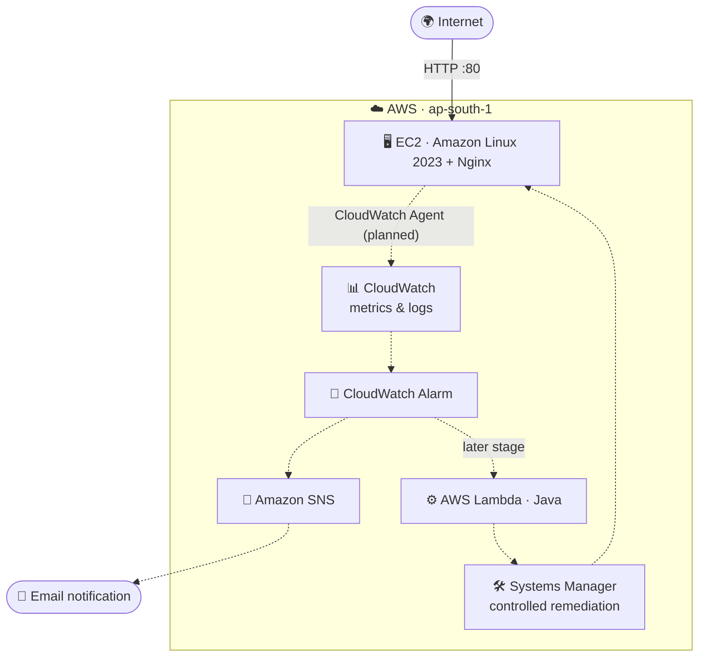

<div align="center">

# ☁️ AWS Monitoring & Alerting System

**Infrastructure as Code · Observability · Automated Remediation**

A student-built, SRE/DevOps-oriented project that provisions AWS infrastructure with Terraform, then progressively adds monitoring, alerting, and automated remediation.

<br>


-ED8B00?style=for-the-badge&logo=openjdk&logoColor=white)


</div>

---

## 📌 Project Status

> **As of 18 October 2026**
>
> ✅ Terraform configuration is written, validated, committed, and pushed to GitHub.
> ✅ `terraform plan` reported **10 to add, 0 to change, 0 to destroy**.
> ⏳ The AWS infrastructure has **not been deployed yet**.
> 🔭 CloudWatch alarms, SNS notifications, Java Lambda remediation, and CI/CD are **future stages, not completed features**.

---

## 🎯 Goals

- 🧱 Define repeatable AWS infrastructure as code using **Terraform**.
- 🌐 Host a basic **Nginx** web service on **Amazon EC2**.
- 📊 Build toward metrics and log collection with **Amazon CloudWatch**.
- 🔔 Send alarm notifications through **Amazon SNS**.
- ⚙️ Add a **Java AWS Lambda** remediation workflow later, with tightly scoped permissions.
- 📝 Use **GitHub** to document changes, tests, screenshots, and interview learnings.
- 💸 Keep the implementation low-cost, avoiding unnecessary services such as a NAT Gateway or load balancer.

---

## 🏗️ Target Architecture



> **Note:** This is the *target* architecture, not a claim that all components are already deployed. Solid lines show the first stage; dashed lines show planned work.

---

## 🧩 Current Implementation

Terraform files currently in `terraform/`:

| File | Responsibility |
|------|----------------|
| `versions.tf` | Sets the Terraform/provider version constraints. |
| `provider.tf` | Configures the AWS provider region (`ap-south-1`) and default resource tags. |
| `variables.tf` | Defines configurable values such as project name, network CIDRs, instance type, and administrator IP. |
| `network.tf` | Defines the VPC, public subnet, Internet Gateway, route table, default internet route, and route-table association. |
| `security.tf` | Defines the EC2 security group for HTTP and restricted SSH access. |
| `iam.tf` | Defines the EC2 role, CloudWatch Agent policy attachment, and instance profile. |
| `ec2.tf` | Defines an Amazon Linux 2023 EC2 instance, its instance profile, storage settings, and Nginx bootstrap script. |
| `outputs.tf` | Declares outputs for the instance ID, public IP, and website URL. |
| `.terraform.lock.hcl` | Locks provider selections for repeatable Terraform initialization. |
| `.gitignore` | Excludes local variables, plans, state, and other sensitive/local files. |

---

## 🛰️ AWS Services: Purpose & Status

| Service / Resource | Why it is used | Status |
|--------------------|----------------|--------|
| **Amazon VPC** | Provides an isolated virtual network for the server. | 🟡 Terraform configured; not deployed |
| **Public subnet** | Places the server in a subnet with a route to the Internet Gateway. | 🟡 Terraform configured; not deployed |
| **Internet Gateway & route table** | Provide a path between the public subnet and the internet. | 🟡 Terraform configured; not deployed |
| **Amazon EC2** | Provides the Linux compute host for Nginx and monitoring. | 🟡 Terraform configured; not deployed |
| **Amazon Linux 2023** | Operating system for the EC2 host. | 🟡 Selected in Terraform; not deployed |
| **Nginx** | Example web service and health-check target. | 🟡 Installation specified in EC2 user data; not tested on AWS yet |
| **EC2 security group** | Controls inbound/outbound traffic. HTTP is intended for public testing; SSH must be restricted to the administrator's IP. | 🟡 Terraform configured; not deployed |
| **IAM role / instance profile** | Gives EC2 an identity to access permitted AWS APIs without storing access keys on the server. | 🟡 Terraform configured; not deployed |
| **CloudWatch Agent / CloudWatch** | Collects memory/disk metrics and logs; standard EC2 metrics alone do not provide all OS-level metrics. | 🔵 Planned next |
| **CloudWatch Alarms** | Detect configured metric thresholds or health conditions. | ⚪ Planned |
| **Amazon SNS** | Sends alarm notifications to email. | ⚪ Planned |
| **AWS Lambda (Java)** | Runs event-driven remediation code. | ⚪ Planned |
| **AWS Systems Manager (SSM)** | Executes a tightly controlled command on the EC2 host from Lambda, without opening another inbound management port. | ⚪ Planned; instance role/connectivity requirements still need implementation |
| **GitHub** | Stores source, documentation, and change history. | 🟢 Terraform files pushed |
| **GitHub Actions** | Runs checks such as Terraform formatting/validation on changes. | ⚪ Planned |

**Legend:** 🟢 Done · 🟡 Configured, not deployed · 🔵 Next · ⚪ Planned

---

## 🔐 Security & Cost Notes

### Security

- 🚫 **Never commit** AWS access keys, secret keys, private keys, `terraform.tfvars`, Terraform state, saved plan files, or review files.
- ✅ Keep `.terraform.lock.hcl` in Git; **do not** commit the `.terraform/` working directory.
- 🔒 Restrict SSH (TCP/22) to a trusted IP or use a managed access method. **Never leave SSH open to `0.0.0.0/0`.**
- 👀 Review the plan carefully before applying it.
- 🤫 Configure AWS credentials securely. Do not paste credentials into issues, screenshots, or chat.

### Cost

- 💰 EC2 compute, EBS storage, public IPv4 addresses, CloudWatch usage, SNS, and Lambda may incur charges depending on current pricing and account eligibility.
- ⚠️ Budget alerts notify; they do **not** automatically stop charges.
- 🧹 Avoid NAT Gateway and load balancers for this low-budget learning version.
- 🗑️ Destroy temporary resources when no longer needed, **after** preserving any evidence. Confirm the correct workspace and plan before destroying.

---

## 🧪 Validate Locally

From the `terraform/` directory on Windows CMD:

```bat
"D:\AWS Monitoring System\terraform_1.16.6_windows_amd64\terraform.exe" fmt
"D:\AWS Monitoring System\terraform_1.16.6_windows_amd64\terraform.exe" validate
"D:\AWS Monitoring System\terraform_1.16.6_windows_amd64\terraform.exe" plan
```

> The Terraform executable path is specific to the author's local Windows machine. Adjust it on another machine, or use `terraform` directly if it is on your `PATH`.

---

## 📁 Repository Layout

```text
aws-monitoring-alerting-system/
├── README.md
├── .gitignore
├── docs/
│   ├── architecture.md
│   ├── interview-notes.md
│   └── daily-progress/
└── terraform/
    ├── .gitignore
    ├── .terraform.lock.hcl
    ├── ec2.tf
    ├── iam.tf
    ├── network.tf
    ├── outputs.tf
    ├── provider.tf
    ├── security.tf
    ├── variables.tf
    └── versions.tf
```

---

## 🎓 Learning Outcomes

By completing this project, I aim to demonstrate:

| | |
|---|---|
| 🧱 Infrastructure-as-code fundamentals | 🌐 AWS networking |
| 🔑 IAM least privilege | 🖥️ EC2 provisioning |
| 📊 Monitoring and alerting | ⚡ Event-driven automation |
| 🌿 Safe Git workflows | 💸 Cost awareness |
| 🩺 Incident troubleshooting | |

---

## 👤 Author

<div align="center">

**Arghya Roy**
B.Tech Information Technology student
Interested in cloud computing, DevOps, and site reliability engineering.

</div>
